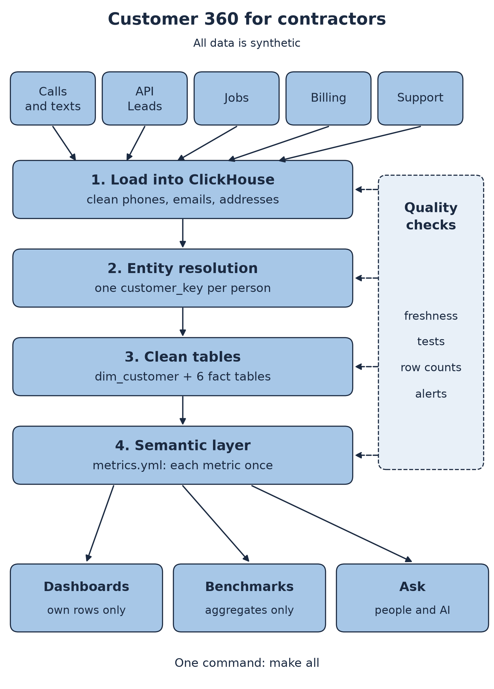
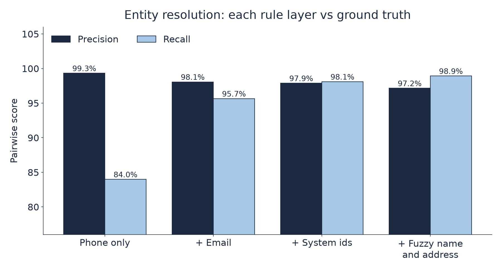
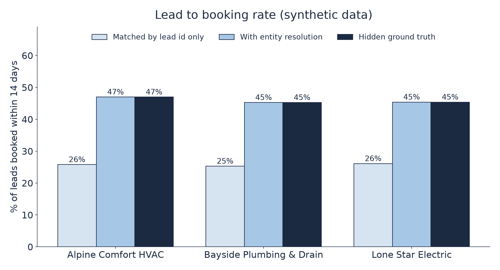

# Customer 360 for Broccoli

Hi Broccoli team, I built this to show how I would approach your Founding Data Engineer role.

It is a small, working version of the data layer in your job post. It runs on ClickHouse. One command builds it all and tests it.

## About me

- I am a Data Scientist at DataQHealth.
- I build healthcare data pipelines that process 10M+ records a year. They cover claims, encounters and patient attribution.
- Matching the same patient across sources is the same problem as matching a homeowner across calls, billing and support.
- I work with CMS data. I automated our ACO work, and the ACO was approved in under 3 months.
- I built a FHIR AI scribe.
- I built an NLP tool for heart device alerts. It saves nurses 3 hours a day.
- MS in Business Analytics and AI, UT Dallas. BSc in Physics, University of Nottingham.
- GitHub: https://github.com/WannaBeSolopreneur
- LinkedIn: https://www.linkedin.com/in/asad-moulvi-aaa278175

## What your job post asks for, and what I built

| Your job post | What I built |
|---|---|
| Pipelines into ClickHouse | Five messy sources load into ClickHouse in layers. Raw, then staging, then clean tables. |
| Entity resolution across billing, support and calls | Six matching rules link records into one `customer_key` per person. Keys stay the same on every rebuild. |
| Clean, documented tables | `dim_customer` and six fact tables. Every column is described in `models/schema.yml`, and the text is copied into ClickHouse comments. |
| Source of truth library | `semantic/metrics.yml` defines 12 metrics once. All metric SQL is made from that file. |
| Human and AI ready | `make ask` answers 10 plain English questions. Each one maps to a defined metric, never to new SQL. |
| Freshness checks, tests and alerts | 74 checks per build. A stale feed or bad row writes an alert before anyone sees a wrong number. |
| Customer dashboards and benchmarks | Every table has `tenant_id`. Tenants read through views that only return their own rows. Benchmarks show aggregates only. |
| Strict customer data isolation | A test starts a real ClickHouse server, adds one user and row policy per tenant, and proves no tenant sees another. |
| ServiceTitan style field service data | Calls, API leads, jobs, invoices, memberships and support tickets. |

## How it fits together



## Results from the last run

These numbers come from `reports/`. The data is synthetic, so they show the method works. They are not claims about real customers.

Entity resolution, scored against the hidden ground truth:

- Precision 97.2%. Of the record pairs I joined, this share really are the same person.
- Recall 98.9%. Of the record pairs that are the same person, this share I joined.
- 0 customers span two tenants.



Why it matters. If you link a lead to a job only by the lead id, you miss bookings. In this data, a job booked from a lead carries the lead id only 60% of the time. That is a generator setting, not a real number. With entity resolution, the lead to booking rate matches the hidden truth.



## Quick start

You need Python 3.11 or newer and `make`.

```
make setup
make all
```

`make all` takes about 20 seconds. It makes the data, builds the warehouse, runs 107 tests and writes the charts.

Try a question:

```
make ask
.venv/bin/python -m c360.ask "Compare lead conversion for each contractor"
```

The row policy test needs a ClickHouse binary. Set `CLICKHOUSE_BIN` to its path. Without it, that one test is skipped.

## All data is synthetic

Every person, phone, email, address and company here is made up by `c360/generate.py`. Phones use 555 numbers. Emails use example domains. No real data was used.

## More detail

Design choices, matching rules, error cases and known limits are in [docs/DETAILS.md](docs/DETAILS.md).
